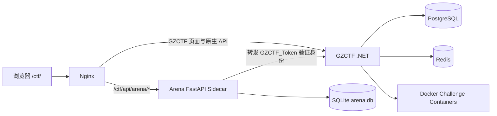

# GZCTF Solo · 方块竞技场

基于 [GZTimeWalker/GZCTF](https://github.com/GZTimeWalker/GZCTF) 扩展的 CTF 平台发行版。它保留原版 GZCTF 的用户、队伍、比赛、题目、容器、附件、动态计分和排行榜能力，并加入“我的世界”体素风格的方块竞技场，以及三套独立玩法：**矿坑决斗 Solo PK**、**One-way One-by-one 单方向单挑**和**Boss Raid 多队讨伐**。

原版项目说明保存在 [`README.upstream.md`](README.upstream.md)，许可证和上游版权文件均原样保留。

## 1. 与原版 GZCTF 的功能对比

| 能力 | 原版 GZCTF | GZCTF Solo |
|---|---|---|
| 标准 Jeopardy CTF | 用户、队伍、比赛、题目、容器、附件、提交、榜单 | 完整保留 |
| 视觉风格 | GZCTF 默认界面 | 新增体素方块、矿坑、Boss 血条和竞技场动效 |
| 1v1 对战 | 以传统比赛/队伍为主 | 六位房间号、1v1、双方到齐后统一倒计时、独立题池与结算 |
| Solo PK 管理 | 无独立房间管理 | 管理员配置题数、时限、计分、首血、连胜、扣分和胜负规则 |
| PK 对局审计 | 无 | 查看开房人员、房间状态、最终比分和胜者；房间与记录分步删除 |
| 单方向单挑 | 无 | 创建前选择 Web/Pwn/Crypto 等方向；每轮一题，首解胜，超时平局 |
| 单挑轮次管理 | 无 | 管理员配置方向题池、轮数、准备倒计时、单轮时限和轮间展示 |
| 单挑结果同步 | 无 | 服务端原子裁决首个正确提交，双方同步弹出“玩家获胜”或“时间结束·平局” |
| Boss 协作 | 无 | 全服/多队共享血量、阶段、护盾、狂暴、伤害映射和贡献榜 |
| 题库同步 | 原生题库 | 竞技场可同步题面、附件 URL、容器目标和 Flag，并保留源题映射 |
| 运行数据 | PostgreSQL/Redis | 原版数据仍在 PostgreSQL/Redis；竞技场状态单独保存在 SQLite |
| 身份认证 | GZCTF Cookie | Sidecar 复用 `GZCTF_Token`，不另建玩家账号 |
| 身份服务容错 | 原版调用链 | 短期身份缓存、请求合并、失败退避与 stale-if-error，降低高频轮询压力 |
| 历史数据升级 | GZCTF migrations | 竞技场 SQLite 使用增量 schema migration，保留 PK/Boss/审计历史 |

## 2. 三种竞技模式

### 2.1 矿坑决斗 · Solo PK

- 玩家创建六位数字房间，另一名玩家输入房间号加入。
- 只有双方都进入后才由服务端设置统一 `startsAt`，客户端按服务端时间倒计时。
- 支持相同题目、公平镜像题池、固定/动态得分、错误扣分、提交冷却、首血和连胜奖励。
- 房间分数、已解题、提交和榜单完全隔离；比赛结束后生成持久化审计记录。
- 管理员可查看双方人员、开始/结束时间、比分、胜负和房间状态，并分别删除运行房间或历史记录。

### 2.2 One-way One-by-one · 单方向单挑

- 房主必须先选择管理员发布的挑战方向，再创建房间。
- 每局从该方向题池无放回抽题；每轮严格只开放一题，未来轮题面不会提前下发。
- 第一位正确提交 Flag 的玩家原子赢得本轮；双方都会收到结果弹窗。
- 单轮超时且无人解出时判定平局；所有轮次结束后按轮胜数判定整场结果。
- 管理员可查看方向、双方玩家、逐轮题目、逐轮胜负和最终结果。

> 公平性要求：映射到原生 GZCTF 的单方向题应先在原生比赛中禁用/隐藏，再仅通过竞技场轮次开放，避免未来题面从原生题库提前暴露。

### 2.3 Boss Raid · 多队讨伐

- 所有参与者共享 Boss 总血量和阶段状态。
- 每题配置基础伤害、所属阶段、属性、护盾题和核心题。
- 支持阶段阈值、护盾、狂暴时间、狂暴伤害倍率和最低个人贡献门槛。
- 正确提交通过事务扣减血量并累计个人/队伍贡献，Boss 血量归零后完成讨伐。

## 3. 架构



关键目录：

```text
GZCTF-solo/
├─ src/GZCTF/ClientApp/src/pages/arena/   # 玩家竞技场页面
├─ src/GZCTF/ClientApp/src/pages/admin/   # 竞技场管理页面
├─ src/GZCTF/ClientApp/src/services/      # Arena API 与状态逻辑
├─ arena-sidecar/                         # FastAPI、SQLite、结算与审计
├─ deploy/                                # 从源码构建的一体化 Compose 模板
└─ README.upstream.md                     # 原版 GZCTF README
```

竞技模式配置以 Sidecar 的 `arena_games` 为运行时真相，不向原生 GZCTF `Game` 表增加字段；这样可以继续使用上游 PostgreSQL migrations，并把竞技场升级限制在独立 SQLite schema 内。

## 4. 快速部署：IP + 端口

### 4.1 环境要求

- Linux x86-64 服务器，建议 4 GB 以上内存、20 GB 以上可用磁盘。
- Docker Engine 24+、Docker Compose v2。
- 一个未占用的 HTTP 端口，默认 `80`。
- 若使用动态容器题，服务器需要 Docker，并确认安全组放行相应题目端口范围。

下列步骤不需要域名，最终可直接访问：

```text
http://HOST:HTTP_PORT/ctf/
```

### 4.2 上传源码

```bash
scp -r GZCTF-solo root@HOST:/opt/GZCTF-solo
ssh root@HOST
cd /opt/GZCTF-solo/deploy
```

### 4.3 创建环境配置

```bash
cp .env.example .env

# 可分别运行三次，为数据库、管理员和竞技场生成独立随机值
python3 -c 'import secrets; print(secrets.token_urlsafe(48))'
```

编辑 `deploy/.env`：

```dotenv
HTTP_PORT=80
PUBLIC_ENTRY=http://HOST
ARENA_TRUSTED_HOSTS=HOST,localhost,127.0.0.1
POSTGRES_PASSWORD=替换为随机数据库密码
GZCTF_ADMIN_PASSWORD=替换为管理员强密码
ARENA_FLAG_PEPPER=替换为固定保存的随机字符串
```

将所有 `HOST` 替换为服务器 IP。如果使用非 80 端口，访问地址为 `http://HOST:HTTP_PORT/ctf/`。

`ARENA_FLAG_PEPPER` 在首次保存竞技场 Flag 后必须保持不变；改变它会使历史 Flag 校验失效。

### 4.4 构建并启动

```bash
docker compose config
docker compose --profile build run --rm frontend-builder
docker compose build arena-api
docker compose up -d
docker compose ps
```

部署使用上游 GZCTF 后端镜像，并把当前源码构建出的定制前端只读挂载到 `/app/wwwroot`；竞技模式逻辑由本仓库的 Sidecar 提供。这与已验证的生产架构一致，也避免重新分发上游受限组件的构建凭据。首次构建会安装 Node/pnpm 和 Python 依赖，耗时取决于服务器网络与性能。启动完成后检查：

```bash
curl -fsS http://127.0.0.1:${HTTP_PORT:-80}/ctf/ >/dev/null
curl -fsS http://127.0.0.1:${HTTP_PORT:-80}/ctf/api/arena/openapi.json >/dev/null
docker compose logs --tail=100 gzctf arena-api nginx
```

浏览器打开：

```text
http://HOST:HTTP_PORT/ctf/
```

使用 `.env` 中的管理员密码登录 `Admin`。管理员密码只用于首次初始化；已有数据库不会因修改环境变量而自动重置账号。

## 5. 管理员初始化竞技场

1. 在 GZCTF 创建比赛和原生题目。
2. 进入“比赛管理 → 方块竞技场 → 题目与内容”。
3. 从 GZCTF 题库同步题目，确认题面、附件 URL、容器目标和 Flag。
4. 为题目勾选 `PK`、`单方向单挑` 或 `Boss`，设置开放状态和各模式参数。
5. 配置模式：
   - Solo PK：题目数、比赛时长、计分与胜负规则。
   - 单方向单挑：新增方向、选择方向题池、设置轮数和单轮时间。
   - Boss：总血量、阶段阈值、护盾、狂暴和最低贡献。
6. 打开“启用竞技场”和“发布到玩家端”，保存配置。
7. 玩家从 `/ctf/arena` 进入对应大厅。

`hybrid` 表示 PK + Boss；单方向单挑是独立模式，不会自动并入 hybrid。

## 6. 本地开发与测试

### 6.1 Arena Sidecar

```bash
cd arena-sidecar
python3 -m venv .venv
source .venv/bin/activate
pip install -r requirements-dev.txt
pytest -q
python -m ruff check .
```

Windows PowerShell 激活命令：

```powershell
.venv\Scripts\Activate.ps1
```

### 6.2 前端

```bash
cd src/GZCTF/ClientApp
pnpm install --frozen-lockfile
pnpm test:arena-status
pnpm check
VITE_BASE_PATH=/ctf/ pnpm build
```

PowerShell 设置构建前缀：

```powershell
$env:VITE_BASE_PATH='/ctf/'
pnpm build
```

### 6.3 .NET

```bash
cd src
dotnet restore GZCTF.slnx
dotnet test GZCTF.slnx
dotnet publish GZCTF/GZCTF.csproj -c Release -o ../publish --no-self-contained
```

上游 GZCTF 的完整 .NET 源码随本目录保留。直接编译当前上游版本时，Six Labors ImageSharp 4 可能要求 `SixLaborsLicenseKey` 或许可证文件；一体化部署默认使用上游预构建后端镜像，因此不依赖该构建凭据。

## 7. 数据备份与升级

升级前同时备份 PostgreSQL、竞技场 SQLite 和 `deploy/.env`。

### PostgreSQL

```bash
cd /opt/GZCTF-solo/deploy
docker compose exec -T db pg_dump -U postgres -d gzctf -Fc > gzctf-$(date +%F-%H%M).dump
```

### 竞技场 SQLite 在线备份

不要在 Sidecar 运行时只复制 `arena.db`，因为数据库可能处于 WAL 模式。使用 SQLite Backup API：

```bash
docker compose exec -T arena-api python -c \
  "import sqlite3; s=sqlite3.connect('/data/arena.db'); d=sqlite3.connect('/data/arena-backup.db'); s.backup(d); d.close(); s.close()"

docker compose cp arena-api:/data/arena-backup.db ./arena-$(date +%F-%H%M).db
```

### 从源码升级

```bash
docker compose stop nginx
docker compose --profile build run --rm frontend-builder
docker compose build arena-api
docker compose up -d --no-deps gzctf arena-api nginx
docker compose ps
```

停止 Nginx 后再重建前端可避免用户在构建过程中请求到不完整资源。模板还要求浏览器重新验证静态 chunk，降低升级时新入口与旧缓存混用的风险。保持原有 named volumes 和 `ARENA_FLAG_PEPPER`。Sidecar 启动时会执行增量 schema migration；应先在数据库备份副本上验证新版本。

## 8. 常见问题

### 页面显示“身份服务暂不可用”

```bash
docker compose exec arena-api python -c \
  "import urllib.request; print(urllib.request.urlopen('http://gzctf:8080/api/account/profile').status)"
docker compose logs --tail=200 arena-api gzctf
```

重点检查 `gzctf` 与 `arena-api` 是否在同一网络、`GZCTF_INTERNAL_URL` 是否正确，以及 GZCTF 是否健康。未携带 Cookie 的 profile 请求返回 401 属于正常现象，连接超时或 5xx 才表示链路异常。

### 题目显示“尚未开启”

检查竞技场是否同时满足：已启用、已发布、模式正确、题目状态为 `active/open`、已配置 Flag，且题目勾选了当前模式。单方向模式还要求每个方向的唯一题数不少于轮数。

### 单方向模式没有可选方向

先在“题目与内容”勾选“单方向单挑”并保存，使题目取得竞技场 ID；再进入“单方向单挑规则”新增方向并选题。映射的原生题应先隐藏。

### 两名玩家进入后未倒计时

确认双方使用不同的有效 GZCTF 账号，并加入同一个六位房间号。倒计时以房间响应中的服务端 `startsAt` 为准，不以本地点击时间为准。

### 使用 IP 访问返回 Trusted Host 错误

把服务器 IP 加入 `deploy/.env` 的 `ARENA_TRUSTED_HOSTS`，然后执行：

```bash
docker compose up -d --force-recreate arena-api
```

## 9. 安全与运维要点

- 不要提交 `deploy/.env`、数据库备份、管理员密码或 Flag Pepper。
- `arena-api:8090` 和 `gzctf:8080` 只在 Compose 网络暴露，公网仅开放 Nginx 端口。
- GZCTF 为动态题挂载 Docker Socket，部署主机应专用于平台并限制管理员权限。
- 定期备份 PostgreSQL、SQLite 和附件卷，并实际演练恢复。
- 修改竞技场 Flag 时通过管理 API 写入；公开 API 不返回 Flag 或哈希。
- 发布单方向题前隐藏原生源题，避免未来轮题面泄露。

## 10. 许可证与上游

- 上游项目：[GZTimeWalker/GZCTF](https://github.com/GZTimeWalker/GZCTF)
- 原版说明：[`README.upstream.md`](README.upstream.md)
- 本目录继续保留 `LICENSE.txt`、`LICENSE_ADDENDUM.txt`、`NOTICE`、`TRADEMARKS.md` 和 `PROPRIETARY_COMPONENTS.md`。
